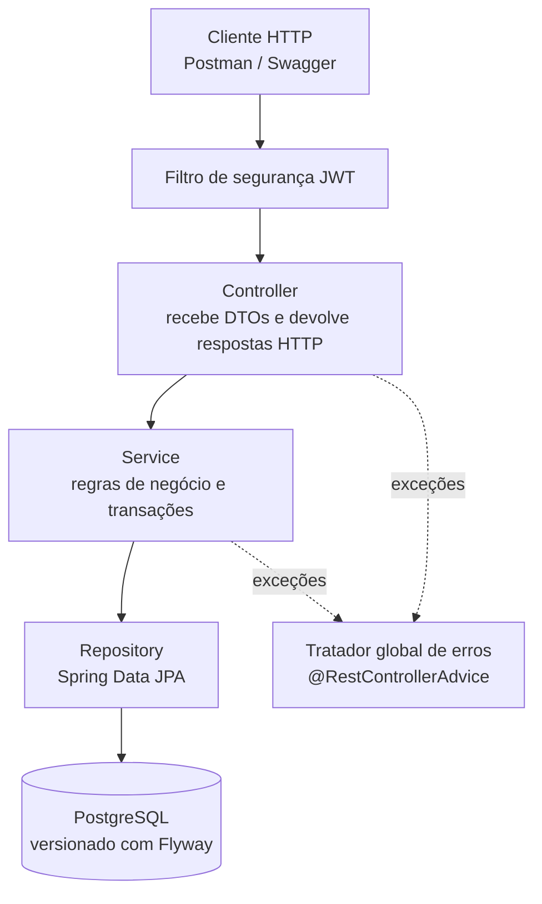
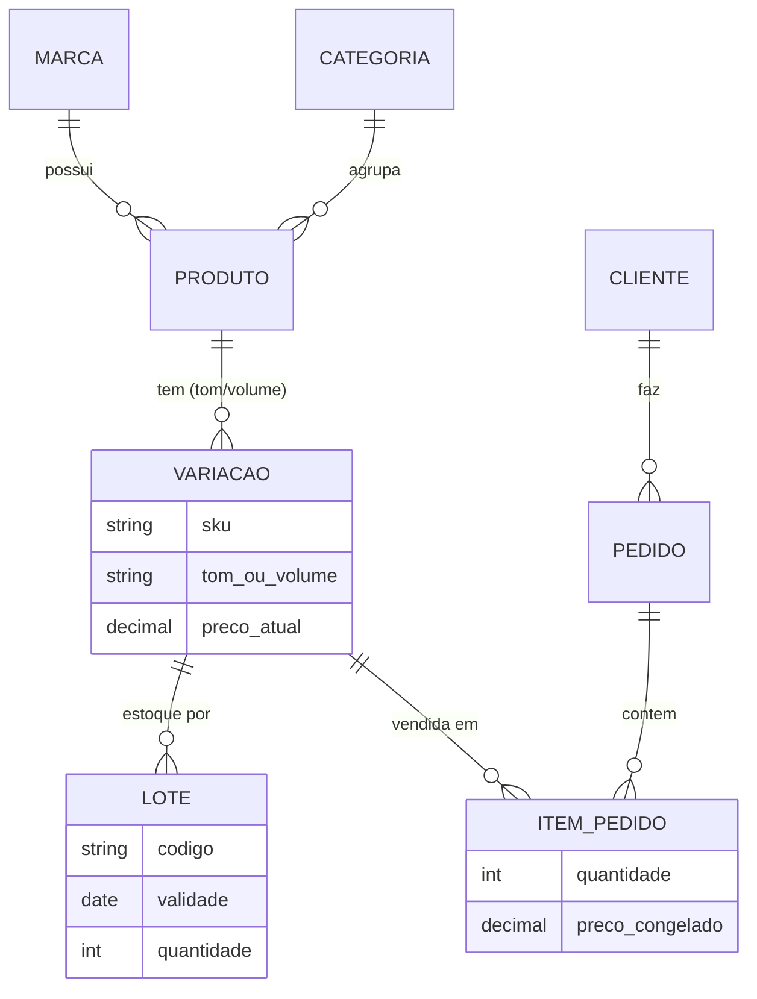
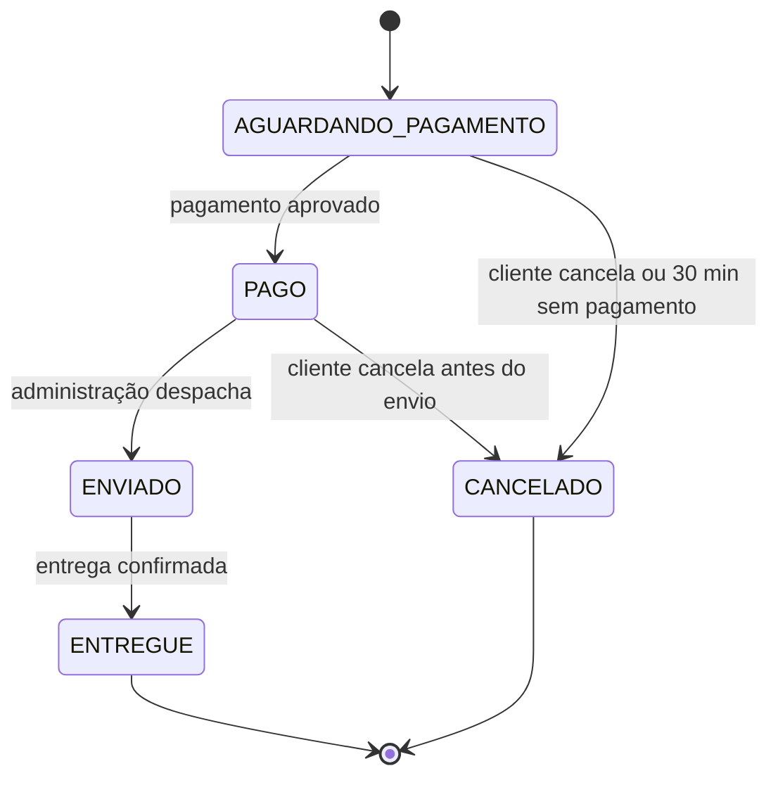

# API de E-commerce de Cosméticos


API REST de um e-commerce de maquiagem e skincare, construída com **Java 21** e **Spring Boot 3**.
O projeto resolve problemas reais do varejo de cosméticos: **produtos com variações** (tom e volume),
**estoque controlado por lote e validade**, **pedidos com ciclo de vida bem definido** e **vendas concorrentes**
em promoções relâmpago.

> **Projeto em desenvolvimento.**
---

## 📌 Sumário

- [Sobre o projeto](#-sobre-o-projeto)
- [Funcionalidades](#-funcionalidades)
- [Tecnologias](#-tecnologias)
- [Arquitetura](#-arquitetura)
- [Modelo de domínio](#-modelo-de-domínio)
- [Ciclo de vida do pedido](#-ciclo-de-vida-do-pedido)
- [Como executar](#-como-executar)
- [Decisões técnicas](#-decisões-técnicas)
- [Roadmap](#-roadmap)
- [Autora](#-autora)

---

## 💡 Sobre o projeto

Um e-commerce de cosméticos tem desafios que vão além de um CRUD:

- **Variações (SKU):** a mesma base existe em vários tons, e o mesmo sérum em 30 ml e 50 ml. O estoque e o preço pertencem à variação, e não ao produto.
- **Lote e validade:** cosmético vence. Cada entrada no estoque é um lote com data de validade, produtos vencidos não podem ser vendidos, e o lote que vence primeiro sai primeiro (**FEFO**: *First Expired, First Out*).
- **Preço congelado:** o preço muda com promoções, mas cada pedido guarda o valor do momento da compra.
- **Concorrência:** em promoções relâmpago, duas clientes não podem comprar a mesma última unidade.

A API atende três perfis:

| Perfil | Permissões |
|---|---|
| **Visitante** | Navegar no catálogo |
| **Cliente** | Montar o carrinho, fechar e pagar pedidos, cancelar pedidos ainda não enviados e ver o próprio histórico |
| **Administrador** | Gerenciar marcas, categorias, produtos, variações, lotes, estoque e pedidos |

---

## ✨ Funcionalidades

- [ ] Catálogo de marcas, categorias, produtos e variações, com paginação e filtros
- [ ] Estoque por lote com controle de validade e histórico de movimentações
- [ ] Relatório de lotes próximos do vencimento
- [ ] Carrinho de compras
- [ ] Fechamento de pedido transacional, com preço congelado e baixa de estoque por FEFO
- [ ] Pagamento simulado e máquina de estados do pedido
- [ ] Cancelamento com devolução das unidades aos lotes de origem
- [ ] Cancelamento automático de pedidos não pagos em 30 minutos
- [ ] Proteção contra venda concorrente da mesma unidade
- [ ] Autenticação com JWT e autorização por perfil
- [ ] Documentação interativa com Swagger

---

## 🛠 Tecnologias

| Categoria | Ferramentas |
|---|---|
| Linguagem e framework | Java 21, Spring Boot 3, Maven |
| Persistência | Spring Data JPA, PostgreSQL, Flyway |
| Validação | Bean Validation |
| Segurança | Spring Security, JWT, BCrypt *(planejado)* |
| Testes | JUnit 5, Mockito, Testcontainers *(planejado)* |
| Documentação | springdoc-openapi (Swagger UI) |
| Infraestrutura | Docker, Docker Compose, GitHub Actions *(planejado)* |

---

## 🏗 Arquitetura

Arquitetura em camadas, organizada **por módulo de negócio** (`catalogo`, `estoque`, `cliente`, `carrinho`, `pedido`, `seguranca`).



| Camada | Responsabilidade |
|---|---|
| **Controller** | Recebe e valida o formato da requisição, devolve o código HTTP. Não contém regra de negócio. |
| **Service** | Aplica as regras de negócio (estoque, lote, preço, status) e controla as transações. |
| **Repository** | Apenas consulta e persiste dados. |
| **Tratador de erros** | Converte exceções em respostas de erro padronizadas. |

---

## 🧩 Modelo de domínio



---

## 🔄 Ciclo de vida do pedido



Qualquer transição fora do diagrama é recusada. Ao cancelar, as unidades voltam aos lotes de origem.

---

## 🚀 Como executar

### Pré-requisitos

- Java 21
- Docker e Docker Compose

### Passo a passo

```bash
# 1. Clone o repositório
git clone https://github.com/marilurezende/<nome-do-repositorio>.git
cd <nome-do-repositorio>

# 2. Suba o banco de dados
docker compose up -d

# 3. Rode a aplicação
./mvnw spring-boot:run
```

A API ficará disponível em `http://localhost:8080`.

### Documentação da API

Com a aplicação rodando, acesse o Swagger UI:

```
http://localhost:8080/swagger-ui.html
```

### Testes

```bash
./mvnw test
```

---

## 🧠 Decisões técnicas

- **Estoque no lote, não no produto.** É o que permite controlar a validade e aplicar o FEFO.
- **Preço na variação, e preço congelado no item do pedido.** O histórico de pedidos não muda quando o preço muda.
- **`BigDecimal` para valores monetários**, mapeado como `NUMERIC` no banco, para evitar erros de arredondamento.
- **DTOs na entrada e na saída da API.** As entidades nunca são expostas diretamente.
- **Migrations com Flyway.** O esquema do banco é versionado junto com o código.
- **Organização por módulo**, para manter juntas as classes de um mesmo assunto.

---

## Roadmap

| Versão | Entrega | Status |
|---|---|---|
| v0.0 | Preparação do ambiente e modelagem | finalizado ✅ |
| v0.1 | Catálogo (marcas, categorias, produtos e variações) | ⏳ |
| v0.2 | Estoque por lote e validade | ⏳ |
| v0.3 | Validação e tratamento de erros | ⏳ |
| v0.4 | Testes unitários e de integração | ⏳ |
| v0.5 | Carrinho e pedidos | ⏳ |
| v0.6 | Concorrência e expiração de pedidos | ⏳ |
| v0.7 | Autenticação e autorização com JWT | ⏳ |
| v1.0 | Swagger completo, CI e Docker da aplicação | ⏳ |

---

## 👩‍💻 Autora

**Maria Luiza Rezende**, estudante de Engenharia de Software

[](https://github.com/marilurezende)
[](https://www.linkedin.com/in/<seu-usuario>)
